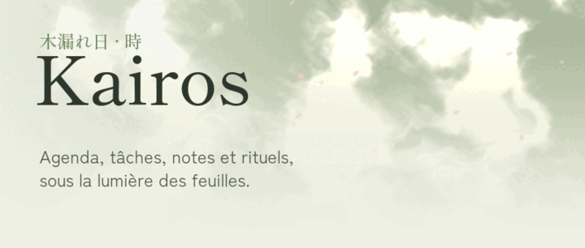
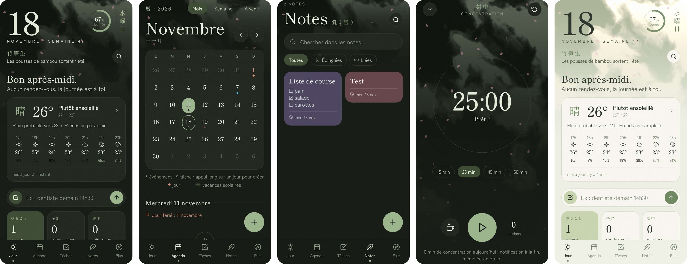
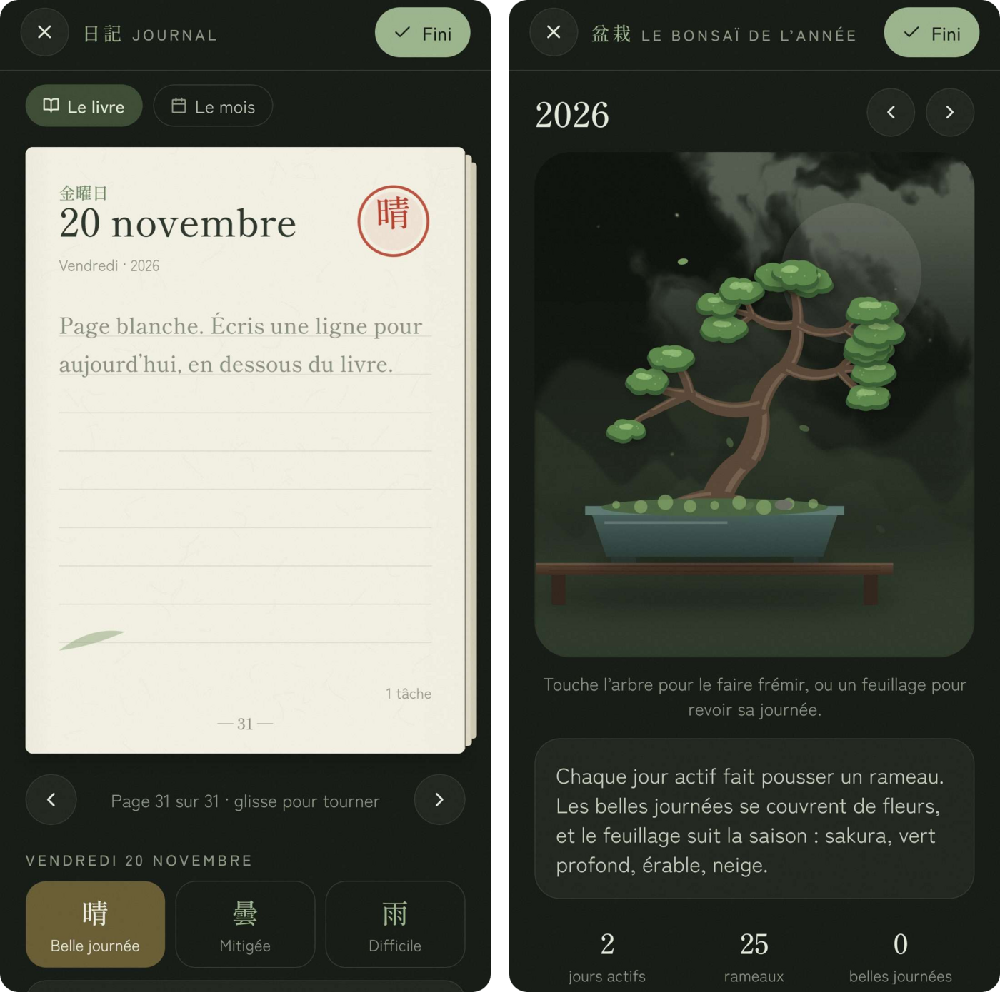
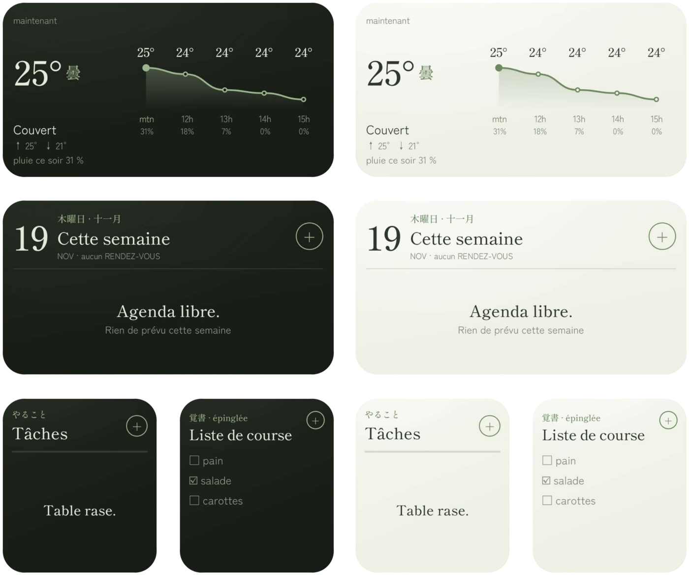
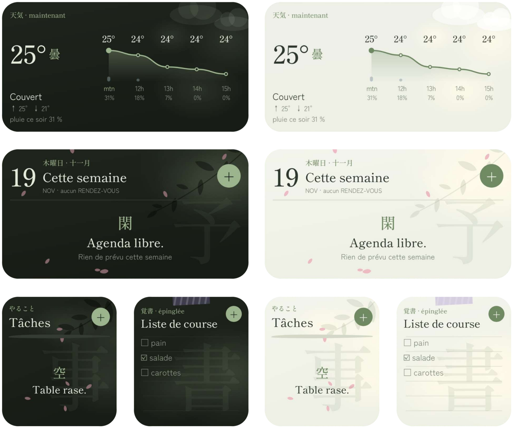
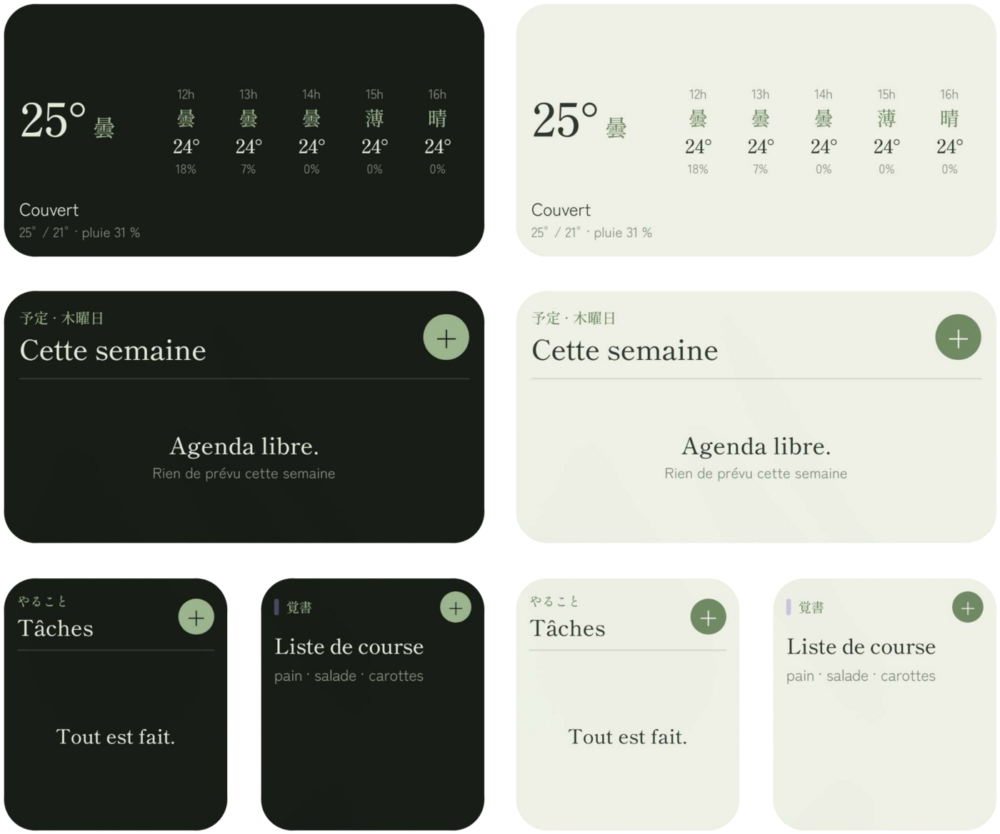

<div align="center">

[Français](README.md) · **English**



# Kairos

**Your calendar, tasks and notes, under the light through the leaves.**

*Kairos*: Greek for “the opportune moment”. Not the time that passes, but the moment you seize.

[](https://github.com/Elicopter-Nc/kairos/releases/latest)
&nbsp;


<br />



<sub>Day · Calendar · Notes · Focus · and the same Day screen in light mode (screenshots in French; the app is also available in English)</sub>

</div>

<br />

Kairos is a calm, beautiful logbook for Android: **calendar, tasks, notes, rituals and a Focus timer** in one app. At the top of every screen, leaf shadows sway gently, like *komorebi* (木漏れ日, sunlight filtering through leaves). Their tint follows the real sun: golden at dawn, bright at noon, amber in the evening. They slide when you tilt your phone, and the season joins in: cherry petals, fireflies, maple leaves, snow or rain.

No account, no ads, no trackers. **Everything stays on your phone.**

## What makes it different

🍃 **An app that breathes.** Washi paper, verdigris ink, Japanese typography, paper grain. Night mode included, plus an optional accent colour that follows the season (sakura, matcha, maple, snow).

✍️ **You type, it understands.** Type “dentiste demain 14h30” or “sport tous les lundis 7h #perso” and the event or task is created on its own, date and time included. *Quick entry understands French only for now.*

🌦️ **Weather in the same style.** The next hours, the week, sunrise. A notification warns you ~45 min before a shower, and before an appointment in the rain.

🗾 **The 72 Japanese micro-seasons.** Each day, the poetic name of the current season (“bamboo shoots sprout”), northern or southern hemisphere.

🖌️ **Small, careful gestures.** Checking off a task draws a brush stroke and drops a leaf. Swipe right to finish, left to push it to tomorrow.

📖 **A journal that is a real book.** One page per day, turned with your finger: the paper curls and reveals the next page. Each page carries the date in kanji, the stamp of your mood (晴 曇 雨), your lines, a pressed flower of the season and the day’s summary.

🌳 **Your year as a bonsai.** Every active day grows a new twig, good days blossom, and the foliage follows the season. It sits on a low table in front of ink-wash mountains. Tap a foliage cloud to see its day again.

<div align="center">



<sub>The journal · The bonsai of the year</sub>

</div>

🌐 **In English or French.** The app follows your phone’s language, or the one you pick in More → Appearance → Language.

📱 **Widgets that adapt.** Tasks (checkable from the home screen), Calendar, Weather and Notes, from a small 2×1 strip to a large 4×4. **Three styles** in More → Widget, in Day and Night mode. The Notes widget can show **the note of your choice** (long-press the widget → Configure).

<div align="center">

**Épuré (Clean)** · v3, default: soft light, just the essentials



</div>

<details>
<summary><b>See the Komorebi and Simple styles</b></summary>

<div align="center">

**Komorebi** · v2: leaf shadows, seasonal particles, kanji watermark, washi paper



**Simple** · v1: flat, no decoration



</div>
</details>

## Everything inside

| | |
|---|---|
| **Day** | The date in large type, the day’s gauge, the micro-season, the weather, quick entry, your schedule, your tasks, your rituals and a thought for the day |
| **Calendar** | Month, Week and Upcoming views. Repeats, reminders, colours, location on a map. French public and school holidays. Your phone’s Google calendars, read-only |
| **Tasks** | Lists, **tags**, priorities, due dates with reminders, subtasks, **recurring tasks** (every 3 days, every month…), reordered with your finger |
| **Notes** | Colourful mosaic, **tags** to find them in a tap, **reminders** at a date and time, checkboxes, photos, link previews, pins. Linked to an event or not |
| **Focus** | Pomodoro timer that rings even with the screen off, **rain** or **stream** ambience and a closing bell |
| **Rituals** | Daily habits with streaks and history |
| **Journal** | A real book: one page per day that you turn with your finger, with your day’s sky (晴 曇 雨) and a few lines |
| **Bonsai** | Your year as a tree: every active day grows a twig, good days blossom, the foliage follows the season |
| **Notifications** | Reminders with “Done” and “In 10 min” buttons, morning brief, rain alert, “leave now” reminder based on travel time |
| **Search** | Everywhere at once: tasks, events and notes. Type `#tag` to see everything with that tag |
| **Trash** | What you delete stays 30 days, with an “Undo” button right after |
| **Languages** | English or French, following your phone or chosen in More. Quick entry is in French |

## Install

1. On your Android phone, go to [**Releases**](https://github.com/Elicopter-Nc/kairos/releases/latest) and download the `.apk` file.
2. Open it. Android asks you to allow installs from this source: that’s expected, the app isn’t on the Play Store.
3. For widgets: long-press the home screen → Widgets → **Kairos**.

Fixes then arrive **on their own** (restart the app when it offers to). When a version needs a new APK, a banner tells you with the link: install it over the old one, your data is kept.

## Privacy

- No account, no ads, no trackers, no usage statistics.
- Your tasks, notes, events and photos stay on your phone. You can back them up to a file (More → Data → Export).
- Online features are **all optional** and off by default. If you turn on weather, your position **rounded to ~1 km** is sent to [Open-Meteo](https://open-meteo.com). Places go through OpenStreetMap, public holidays through api.gouv.fr. Offline, the last known weather stays on screen.

## Development

### Try it with Expo Go

```bash
cd kairos
npm install
npx expo start
```

Scan the QR code with Expo Go. Everything works **except widgets**, since Expo Go can’t display native widgets. The More tab tells you whether widgets are available.

### Build the APK (with widgets)

```bash
npx eas-cli@latest login
npx eas-cli@latest build -p android --profile preview
```

EAS gives you a link to download the APK: install it on your phone. Then long-press the home screen → Widgets → **Kairos**.

Local build (if Android Studio / SDK is installed): `npx expo run:android --variant release`.

Pushing a `v*` tag also builds the APK on GitHub Actions and attaches it to the release.

### Data

- Storage: AsyncStorage, a single JSON key (`kairos:db:v1`).
- Notifications: all local. On every change, the app reschedules reminders for the next 21 days.
- Backup: More → Data → Export (a `.json` file to keep wherever you like) / Restore.

### Structure

```
index.ts                  entry point (expo-router + widget registration)
src/app/                  screens (Expo Router)
  (tabs)/                 Day, Calendar, Tasks, Notes, More
  event/[id].tsx          event editor
  task/[id].tsx           task editor
  note/[id].tsx           note editor
  focus.tsx  habits.tsx   Focus, Rituals
  journal.tsx jardin.tsx  Journal (book), Bonsai
src/components/           Matcha UI (Card, Btn, Chip, Enso…), list items, editors
src/data/                 types, storage, React store, recurrences
src/lib/                  dates, notifications, native pickers, backup, stats
src/i18n/                 translations (French text is the key, English dictionaries in en/)
src/widget/               Android widget (rendering + tap handling)
src/theme.tsx             Day / Night palettes, swatches, kanji
src/components/Komorebi.tsx  light shader (Skia + Reanimated)
scripts/subset-fonts.sh   regenerates the trimmed fonts (if you add a kanji)
```

## Contributing

Contributions are welcome! You can:

- **report a bug or suggest an idea** by opening an [issue](https://github.com/Elicopter-Nc/kairos/issues) (a screenshot helps a lot);
- **propose a change** with a pull request: a fix, a new feature, a better translation (`src/i18n/en/`)…

For a big feature, open an issue first so we can talk about it and avoid wasted work. Before sending a PR, check that `npx tsc --noEmit` and `npx expo lint` pass, and keep the spirit of the app: calm, light, no account and no trackers.

## Credits

- Weather: [Open-Meteo](https://open-meteo.com) (CC BY 4.0).
- Maps, addresses and routes: © [OpenStreetMap](https://www.openstreetmap.org/copyright) contributors, Nominatim, FOSSGIS (routing.openstreetmap.de).
- Public and school holidays: api.gouv.fr, data.education.gouv.fr (Licence Ouverte).
- Fonts: Shippori Mincho and Zen Kaku Gothic New (SIL Open Font License, texts in `assets/fonts/`), trimmed for the app.
- Built with Expo, React Native, Skia and Reanimated.

## License

[MIT](LICENSE)
