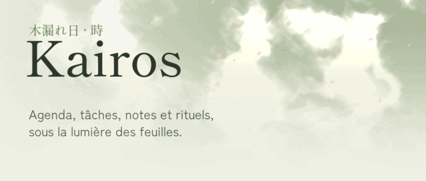
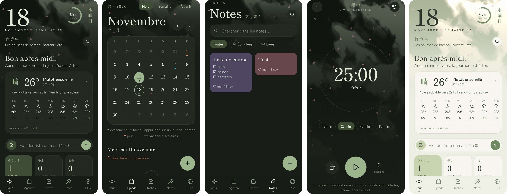
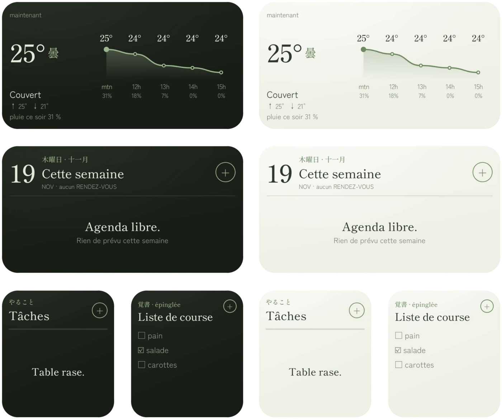
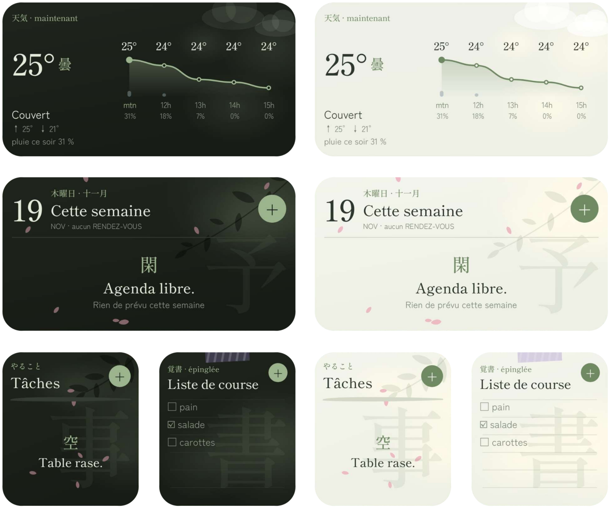
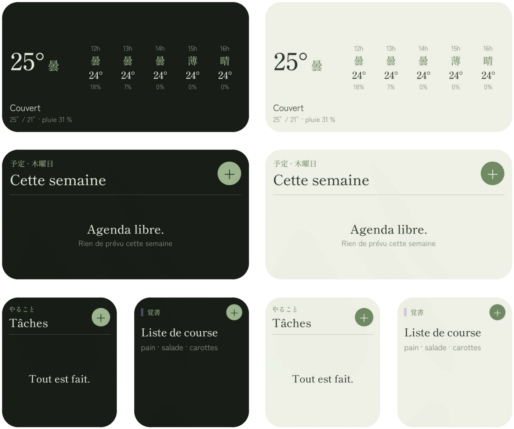

<div align="center">



# Kairos

**Ton agenda, tes tâches et tes notes, sous la lumière des feuilles.**

*Kairos* : en grec, « le moment opportun ». Pas le temps qui passe, celui qu'on saisit.

[](https://github.com/Elicopter-Nc/kairos/releases/latest)
&nbsp;


<br />



<sub>Jour · Agenda · Notes · Focus · et le même écran Jour en mode clair</sub>

</div>

<br />

Kairos est un carnet de bord pour Android, calme et beau : **agenda, tâches, notes, rituels et minuteur Focus** dans une seule app. En haut de chaque écran, des ombres de feuillage bougent doucement, comme du *komorebi* (木漏れ日, la lumière qui passe à travers les feuilles). Leur teinte suit le vrai soleil : dorée à l'aube, claire à midi, ambrée le soir. Elles glissent quand tu inclines le téléphone, et la saison s'y invite : pétales de cerisier, lucioles, feuilles d'érable, neige ou pluie.

Pas de compte, pas de pub, pas de traqueur. **Tout reste sur ton téléphone.**

## Ce qui la rend différente

🍃 **Une app qui respire.** Papier washi, encre vert-de-gris, typographie japonaise, grain de papier. Mode Nuit inclus, et en option une couleur qui suit la saison (sakura, matcha, érable, neige).

✍️ **Tu écris, elle comprend.** Tape « dentiste demain 14h30 » ou « sport tous les lundis 7h #perso » : l'événement ou la tâche se crée tout seul, date et heure comprises.

🌦️ **La météo dans le même style.** Les prochaines heures, la semaine, le lever du soleil. Une notification te prévient ~45 min avant une averse, et avant un rendez-vous sous la pluie.

🗾 **Les 72 micro-saisons japonaises.** Chaque jour, le nom poétique de la saison du moment (« les pousses de bambou sortent »), hémisphère nord ou sud.

🖌️ **Des petits gestes soignés.** Cocher une tâche trace un coup de pinceau et fait tomber une feuille. Glisse à droite pour finir, à gauche pour reporter à demain.

📱 **Des widgets qui s'adaptent.** Tâches (cochables depuis l'écran d'accueil), Agenda, Météo et Notes, de la petite bande 2×1 au grand 4×4. **Trois styles au choix** dans Plus → Widget, en mode Jour comme en mode Nuit. Le widget Notes peut afficher **la note de ton choix** (appui long sur le widget → Configurer).

<div align="center">

**Épuré** · v3, par défaut : une lumière douce, l'essentiel



</div>

<details>
<summary><b>Voir les styles Komorebi et Simple</b></summary>

<div align="center">

**Komorebi** · v2 : ombre de feuillage, particules de saison, kanji en filigrane, papier washi



**Simple** · v1 : aplat, sans décor



</div>
</details>

## Tout ce qu'il y a dedans

| | |
|---|---|
| **Jour** | La date en grand, la jauge de la journée, la micro-saison, la météo, la saisie rapide, ton programme, tes tâches, tes rituels et une pensée du jour |
| **Agenda** | Vues Mois, Semaine et À venir. Répétitions, rappels, couleurs, lieu sur une carte. Jours fériés et vacances scolaires. Tes calendriers Google du téléphone en lecture |
| **Tâches** | Listes, **tags**, priorités, échéances avec rappel, étapes, **tâches récurrentes** (tous les 3 jours, chaque mois…), réordonnées au doigt |
| **Notes** | Mosaïque colorée, **tags** pour les retrouver d'un geste, **rappel** à une date et une heure, cases à cocher, photos, aperçu des liens, épingles. Liées ou non à un événement |
| **Focus** | Minuteur pomodoro qui sonne même écran éteint, ambiance **pluie** ou **ruisseau** et cloche de fin |
| **Rituels** | Habitudes du quotidien avec séries et historique |
| **Journal** | Un vrai livre : une page par jour qui se tourne du doigt, avec le ciel de ta journée (晴 曇 雨) et quelques lignes |
| **Bonsaï** | Ton année en un arbre : chaque jour actif fait pousser un rameau, les belles journées fleurissent, le feuillage suit la saison |
| **Notifications** | Rappels avec boutons « Fait » et « Dans 10 min », brief du matin, alerte pluie, rappel « pars maintenant » selon le trajet |
| **Recherche** | Partout à la fois : tâches, événements et notes. Tape `#tag` pour voir tout ce qui porte ce tag |
| **Corbeille** | Ce que tu supprimes reste 30 jours, avec un bouton « Annuler » juste après |
| **Langues** | Français ou anglais (*English*), selon la langue du téléphone ou au choix dans Plus. La saisie rapide se fait en français |

## Installer

1. Sur ton téléphone Android, va dans [**Releases**](https://github.com/Elicopter-Nc/kairos/releases/latest) et télécharge le fichier `.apk`.
2. Ouvre-le. Android demande d'autoriser l'installation depuis cette source : c'est normal, l'app n'est pas sur le Play Store.
3. Pour les widgets : appui long sur l'écran d'accueil → Widgets → **Kairos**.

Les corrections arrivent ensuite **toutes seules** (relance l'app quand elle te le propose). Quand une version demande un nouvel APK, un bandeau te le signale avec le lien : installe-le par-dessus, tes données sont gardées.

## Vie privée

- Aucun compte, aucune publicité, aucun traqueur, aucune statistique d'usage.
- Tes tâches, notes, événements et photos restent sur ton téléphone. Tu peux les sauvegarder dans un fichier (Plus → Données → Exporter).
- Les fonctions en ligne sont **toutes optionnelles** et désactivées par défaut. Si tu actives la météo, ta position **arrondie à ~1 km** est envoyée à [Open-Meteo](https://open-meteo.com). Les lieux passent par OpenStreetMap, les jours fériés par api.gouv.fr. Hors connexion, la dernière météo connue reste affichée.

## Développement

### Tester avec Expo Go

```bash
cd kairos
npm install
npx expo start
```

Scanne le QR code avec Expo Go. Tout fonctionne **sauf le widget**, car Expo Go ne peut pas afficher de widget natif. L'onglet Plus indique si le widget est disponible.

### Construire l'APK (avec widgets)

```bash
npx eas-cli@latest login
npx eas-cli@latest build -p android --profile preview
```

EAS te donne un lien pour télécharger l'APK : installe-le sur le téléphone. Ensuite, appui long sur l'écran d'accueil → Widgets → **Kairos**.

Build local (si Android Studio / SDK installé) : `npx expo run:android --variant release`.

### Données

- Stockage : AsyncStorage, une seule clé JSON (`kairos:db:v1`).
- Notifications : toutes locales. À chaque changement, l'app reprogramme les rappels des 21 prochains jours.
- Sauvegarde : Plus → Données → Exporter (fichier `.json` à garder où tu veux) / Restaurer.

### Structure

```
index.ts                  point d'entrée (expo-router + enregistrement du widget)
src/app/                  écrans (Expo Router)
  (tabs)/                 Jour, Agenda, Tâches, Notes, Plus
  event/[id].tsx          éditeur d'événement
  task/[id].tsx           éditeur de tâche
  note/[id].tsx           éditeur de note
  focus.tsx  habits.tsx   Focus, Rituels
src/components/           UI Matcha (Card, Btn, Chip, Enso…), éléments de liste, éditeurs
src/data/                 types, stockage, store React, récurrences
src/lib/                  dates, notifications, sélecteurs natifs, sauvegarde, stats
src/widget/               widget Android (rendu + gestion des clics)
src/theme.tsx             palettes Jour / Nuit, nuancier, kanji
src/components/Komorebi.tsx  shader de lumière (Skia + Reanimated)
scripts/subset-fonts.sh   régénère les polices allégées (si tu ajoutes un kanji)
```

## Crédits

- Météo : [Open-Meteo](https://open-meteo.com) (CC BY 4.0).
- Cartes, adresses et itinéraires : © contributeurs [OpenStreetMap](https://www.openstreetmap.org/copyright), Nominatim, FOSSGIS (routing.openstreetmap.de).
- Jours fériés et vacances scolaires : api.gouv.fr, data.education.gouv.fr (Licence Ouverte).
- Polices : Shippori Mincho et Zen Kaku Gothic New (SIL Open Font License, textes dans `assets/fonts/`), allégées pour l'app.
- Construit avec Expo, React Native, Skia et Reanimated.

## Licence

[MIT](LICENSE)
